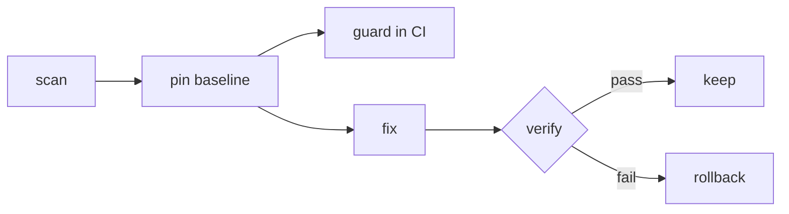

<div align="center">

# 🧹 `unshit`

### Your AI writes code fast. `unshit` stops it from rotting your repo.

**Deterministic dead-code, clone, CSS, i18n, and AI-slop scanner with a gated AI fixer.**

[](https://github.com/elbayoumi/unshit/actions/workflows/ci.yml)
[](https://www.npmjs.com/package/unshit)
[](https://www.npmjs.com/package/unshit)
[](https://nodejs.org)
[](./LICENSE)

```bash
npx unshit score .
```

[Quick Start](#quick-start) · [CLI](#cli-reference) · [Rules](#built-in-rules) · [CI & Agents](#ci--ai-agent-integration) · [Changelog](./CHANGELOG.md)

</div>

| 📊 **Score** | 🔒 **Guard** | 🛡️ **Hook** | 🔧 **Fix** |
|:---:|:---:|:---:|:---:|
| A 0–100 health grade for the whole repo | CI fails only on *new* slop | Blocks slop while the AI agent is writing it | Dry-run by default, AI fixes are verify-gated |



---

## Why `unshit`?

AI coding assistants ship features fast—and silently leave behind **AI slop**: 1,000-line God hooks, hundreds of CSS `!important` overrides, copy-pasted logic blocks, inline `isAr ? ... : ...` i18n leaks, `catch (e: any)` type escapes, and unused exports.

Existing tools each solve one slice of the problem. **`unshit`** borrows ideas from them and combines them into one zero-infrastructure, deterministic pipeline. It is **not** a drop-in replacement for any of them: TS/JS rules use the TypeScript AST, clone detection uses a TypeScript-scanner token window, and CSS plus Rust/Dart/Python rules are lightweight text heuristics. Expect fewer edge cases handled than in the dedicated tools.

| Inspiration | What `unshit` Adopts |
|---|---|
| **[knip](https://github.com/webpro-nl/knip)** | Cross-file export reachability (`ts/unused-export`) |
| **[jscpd](https://github.com/kucherenko/jscpd)** | Rolling token-window clone detection (`code/duplicate-block`) |
| **[biome](https://github.com/biomejs/biome) & [oxc](https://github.com/oxc-project/oxc)** | TypeScript AST diagnostics, safe/unsafe/AI fix classification, SARIF output |
| **[deslop](https://github.com/agent-sh/deslop)** | AI-slop heuristics (`slop/redundant-catch`, `slop/magic-timer`) |
| **Built-in Governance** | **CSS `!important` & scoped duplicate detection** (ignores `@keyframes`), **i18n ternary enforcement**, **God-file metrics**, **`pin`/`guard` CI gates**, **snapshot-protected AI fixes**, and a native **MCP Server** |

---

## Example Output

```text
$ npx unshit score ./apps/web   # illustrative output; your numbers will differ
unshit score: 84/100 (Grade B) — 1411 findings across 801 files (118664 lines)
By category: {"css":395,"types":0,"i18n":38,"architecture":49,"slop":57,"duplication":568,"dead-code":304,"performance":0}
```

---

## Quick Start

### 1. Audit & Score (Read-Only)

```bash
# Compute a deterministic 0–100 health score (Grade A–F)
npx unshit score .

# Scan and print findings
npx unshit scan .

# Fail CI if any error-level findings exist
npx unshit scan . --fail-on error

# Export JSON, Markdown, or SARIF for GitHub Code Scanning
npx unshit scan . --format sarif > unshit.sarif
```

### 2. Pin & Guard (Zero-Regression CI Gate)

Adopt `unshit` on an existing messy repo without fixing everything on day one:

```bash
# 1. Capture line-shift-resilient baseline in unshit.baseline.json
npx unshit pin .

# 2. Run in CI / pre-commit — fails ONLY on newly introduced slop or score drops
npx unshit guard .
```

### 3. Fix Safely (Dry-Run by Default)

```bash
# Preview deterministic patches without touching disk
npx unshit fix .

# Apply deterministic safe patches (e.g. catch (err: any) -> catch (err: unknown))
npx unshit fix . --apply

# Optional: run gated AI fixes per file (OpenCode or Claude) with automatic snapshot rollback on verify failure
npx unshit fix . --apply --ai --runner opencode --model opencode/big-pickle
```

---

## CLI Reference

| Command | Description | Key Options |
|---|---|---|
| `unshit init [path]` | One-command setup: `unshit.config.json`, Claude hook, and baseline pin | `--force` |
| `unshit scan [path]` | Read-only AST, CSS, clone, and slop scan | `--format human\|json\|sarif\|markdown`, `--fail-on error\|warn\|info`, `--deep` |
| `unshit context [path]` | Print (or `--write` into `AGENTS.md`) the deterministic project-rules block: archetype, layout, source roots, verify commands, unshit rule thresholds | `--write` |
| `unshit score [path]` | Compute deterministic 0–100 health score (`Grade A–F`) | `--format human\|json` |
| `unshit hotspots [path]` | Rank files by churn and finding density | `--since 90.days`, `--top 10`, `--json` |
| `unshit pin [path]` | Write `unshit.baseline.json` snapshot | — |
| `unshit guard [path]` | Compare current scan against `unshit.baseline.json` | `--changed` (diff-only PR mode), `--lines` (changed lines only), `--base <ref>` |
| `unshit pr [path]` | PR review: report only findings introduced on branch changes vs base, with fix suggestions | `--base <ref>`, `--format human\|markdown\|json` |
| `unshit fix [path]` | Preview or apply deterministic + gated AI fixes | `--apply`, `--ai`, `--swarm`, `--abort`, `--runner opencode\|claude` |
| `unshit hook [file]` | **Live AI Guardrail Hook** — blocks AI slop in real time (exits `2`) | `--stdin` (Claude Code `PreToolUse` / `PostToolUse` JSON) |
| `unshit mcp` | Start stdio MCP server (`unshit_scan`, `unshit_score`, `unshit_guard`, `unshit_check_patch`, `unshit_explain_architecture`, `unshit_fix_preview`) | — |
| `unshit note <rule> "text"` / `unshit notes` | Record local false-positive / improvement / scope-gap notes in `.unshit/feedback.jsonl`, then print a backlog grouped by rule | `--kind`, `--file`, `--json` |

---

## Built-in Rules

| Rule ID | Tier | Severity | Fixability | What It Catches |
|---|---|---|---|---|
| `css/no-important` | structural | `warn` | `ai` | `!important` overrides in `.css`/`.scss` (ignores comments) |
| `css/duplicate-selector` | structural | `info` | `ai` | Duplicate selectors in the same `@media` / scope (skips `@keyframes`) |
| `ts/no-explicit-any` | structural | `warn` | `safe` / `ai` | Explicit `: any` and `as any` (skips `.d.ts` and test files) |
| `ts/no-double-cast` | structural | `warn` | `ai` | `as unknown as T` type-system bypasses |
| `i18n/no-inline-ternary` | structural | `error` | `ai` | Inline `isAr` / `language === 'ar'` ternaries outside dictionaries |
| `react/god-file` | heuristic | `warn` | `ai` | Modules exceeding `godFileMaxLines` (350) or `godFileMaxHooks` (15) |
| `slop/magic-timer` | structural | `info` | `safe` / `ai` | Raw numeric delays in `setTimeout` / `window.setTimeout` / `setInterval` (deterministic extraction for plain decimal literals) |
| `slop/redundant-catch` | structural | `warn` | `ai` | Empty `catch {}` blocks or `catch (e) { throw e; }` |
| `code/duplicate-block` | structural | `info` | `ai` | Copy-pasted token blocks across files (`cloneMinTokens`: 80) |
| `code/high-complexity` | structural | `warn` | `ai` | Functions/methods/arrows with cognitive complexity above `complexityMax` (25); skips `.d.ts` and test files |
| `ts/unused-export` | structural | `info` | `unsafe` | Exported symbols with zero cross-file references |
| `rust/no-unwrap` | structural | `warn` | `ai` | `.unwrap()` in non-test `.rs` files (skips `#[cfg(test)]`) |
| `dart/no-dynamic-or-print` | structural | `warn` | `ai` | `dynamic` type escapes & `print()` calls in non-test `.dart` files |
| `python/no-bare-except` | structural | `warn` | `ai` | Bare `except:` clauses in non-test `.py` files |
| `arch/import-cycle` | structural | `warn` | `manual` | Circular import cycles (TS/JS, Python, Rust, Dart via iterative Tarjan SCC) |
| `arch/layer-violation` | structural | `error` | `manual` | Cross-layer imports violating `layers[]` rules in `unshit.config.json` |

| `css/design-drift` | structural | `info` | `ai` | Hardcoded colors where design tokens exist |
| `ts/unused-type-export` | structural | `info` | `unsafe` | Exported types with zero cross-file references |
| `structure/*` | structural | `error` / `warn` / `info` | `manual` | Cross-package and feature-boundary imports, feature cycles, junk drawers (see `src/detectors/structure.ts`) |
| `db/query-in-loop` | structural | `warn` | `manual` | ORM queries (Prisma, TypeORM, Drizzle) executed inside loops |

---

## Inline Waivers & Configuration

### Suppressing a Finding (`// unshit-ignore`)

Document why an exception is intentional on the line itself or the line immediately above:

```ts
// unshit-ignore: ts/no-double-cast — legacy IPC bridge payload
const data = raw as unknown as BridgePayload;
```

### `unshit.config.json`

Create `unshit.config.json` in your project root to customize thresholds, excluded paths, or AI verification:

```json
{
  "disabledRules": ["slop/magic-timer"],
  "exclude": ["node_modules", "dist", "coverage"],
  "godFileMaxLines": 400,
  "godFileMaxHooks": 15,
  "complexityMax": 25,
  "cloneMinTokens": 80,
  "aiRunner": "opencode",
  "aiModel": "opencode/big-pickle",
  "verifyCommand": "npm run typecheck && npm test"
}
```

---

## CI & AI Agent Integration

### GitHub Actions (`unshit guard`)

```yaml
name: Codebase Detox Guard
on: [pull_request]
jobs:
  unshit:
    runs-on: ubuntu-latest
    steps:
      - uses: actions/checkout@v4
      - uses: actions/setup-node@v4
        with:
          node-version: "22"
      - run: npx unshit guard .
```

### Live AI Guardrail Hook (Claude Code)

Block AI-generated slop (`!important`, `any`, inline i18n ternaries, `.unwrap()`, `bare except:`) **before** it hits your repo by adding this to `.claude/settings.json`:

```json
{
  "hooks": {
    "PreToolUse": [
      {
        "matcher": "Write|Edit",
        "hooks": [{ "type": "command", "command": "npx -y unshit hook --stdin" }]
      }
    ]
  }
}
```

### MCP Server (Claude Code / Cursor / Antigravity)

Expose `unshit_scan`, `unshit_score`, `unshit_guard`, `unshit_check_patch`, `unshit_explain_architecture`, and `unshit_fix_preview` as MCP tools (the last three are read-only):

```json
{
  "mcpServers": {
    "unshit": {
      "command": "npx",
      "args": ["-y", "unshit", "mcp"]
    }
  }
}
```

---

## Benchmarks

A reproducible head-to-head against knip, jscpd, dependency-cruiser, oxlint and biome on five real repositories is documented in [docs/research/g4-head-to-head.md](./docs/research/g4-head-to-head.md). Measured (median of 3 runs): unshit found 107/52/68/0/0 unused-export findings vs knip's 52/2/14/0/37 across hono/execa/zod/commander.js/fastify; unshit found fewer unused files than knip on hono/execa/zod (31/283/117 vs 173/129/338) but more on fastify (20 vs 17); duplicate-block counts were 23/159/557/1/15 vs jscpd's 699/6/251/14/518; import-cycle counts were 4/1/1/0/1 vs dependency-cruiser's 7/7/1/0/0. Counts are not comparable one-to-one (tools differ in scope); see the report's limitations section. Raw outputs: `docs/research/g4-raw/`.

## Development & Architecture

See [CONTRIBUTING.md](./CONTRIBUTING.md) to get started and [RELEASING.md](./RELEASING.md) for how versions are shipped.

See [ARCHITECTURE.md](./ARCHITECTURE.md) for the full design and safety invariants.

```bash
npm run typecheck
npm test
```

## License

[MIT](./LICENSE) © 2026 Mohamed Ashraf (Crewloom) — see [NOTICE](./NOTICE) for attribution and trademark details.
